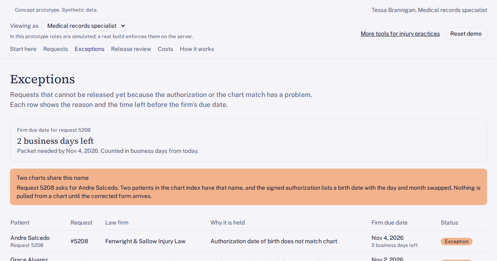

# Records request and release desk for an injury practice

Every law firm records and bill request matched to the right chart and checked before anything is released.

## Who has this problem

Injury-first practices paid mostly through PIP, letters of protection and workers' comp. The records specialist answers every records and itemized bill request that law firms send, often about 70 a week. Requests arrive through several retrieval portals, by fax and by email. There is no single list, so due dates end up on sticky notes. Authorization problems like a wrong birth date, an expired form or a missing signature show up halfway through pulling the chart. Balances are typed in by hand and can miss the latest visits or payments. Paralegals call to ask for status because nobody tells them when a packet goes out.

At about 32 minutes a request, that is roughly 37 specialist hours a week. A late packet holds up the firm's settlement demand on a balance that averages about $9,000. One packet released from the wrong chart is a reportable privacy breach.

## What you can try

The app opens on 140 synthetic records requests from invented law firms. Start on "Start here" and work through three tasks:

- **Open the newest request:** on Requests, click the top row to see its history: when it arrived and how, the chart it matched, the authorization check, pages, bill and balance, and notes.
- **Fix the birth date mismatch:** on Exceptions, open request 5208. Two patients share the name Andre Salcedo, and the authorization's birth date has the day and month swapped, so it matches neither chart. The desk flags it as "Authorization date of birth does not match chart", shows both charts and counts down to the firm's due date. Attach the corrected authorization, then move it to release review.
- **Approve the packet and release it:** on Release review, check the chart, date range, pages, bill and balance, then click "Approve and release packet". Nothing goes to a firm without that click.

**Sample document:** a corrected patient authorization for request 5208 is built in, so you can attach it without a file of your own.

**Role switcher:** view the desk as the medical records specialist, PI billing or the attorney's view.

**Cost calculator:** the Costs screen takes your own request volume, minutes per request and staff rate and compares today's specialist time with the desk. No prices, just your numbers.

**How it works:** a clickable diagram. Click any box to see what it does, what data passes through it and whether it holds patient data.

## How it's built

A browser-only React + TypeScript + Tailwind app on the Umakes kit. All data is synthetic seed data: records requests, request events and ledger lines, generated with relative dates so due dates and countdowns stay current. Nothing leaves your browser.

The app was built and checked by the Umakes App Factory: automated gates for build, types and accessibility, plus a reviewer that uses the app the way a records specialist would and scores it.

The "How it works" screen is the architecture. It shows the retrieval portals, the fax and email inbox, the EHR and the billing ledger feeding the desk, an AI document reader that sees authorization text only, and the specialist approving every release.

## What a production version adds

- **Real integrations:** the retrieval portals firms already use (ChartSwap, ChartSwap Insights, MRO, Ciox (Datavant), Verisma), the records fax and email inbox, the practice EHR and billing ledger, and status updates toward firms on case software such as CasePeer.
- **HIPAA controls:** role-based access, an audit log of every release (who approved it, what was sent and to whom), encryption at rest and in transit, and signed BAAs with any vendor that touches patient data. Only the record types and date range named in the authorization go into a packet.
- **Deployment on the client's own cloud (GCP):** the desk and the document reader run in the practice's own account.
- **Client ownership:** the practice owns the code, the data and the deployment.

## Try it

https://umakescloud-max.github.io/records-request-release-queue-v1/

This is a concept prototype with synthetic data. No real patients, charts or law firms are in it. A real build runs on the client's own cloud, HIPAA-ready, and the client owns it.

If your team fights this every week, book a free workflow audit at umakes.cloud or reply to umakescloud@gmail.com.
